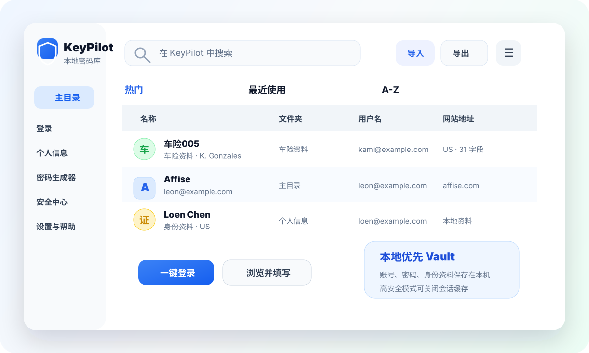
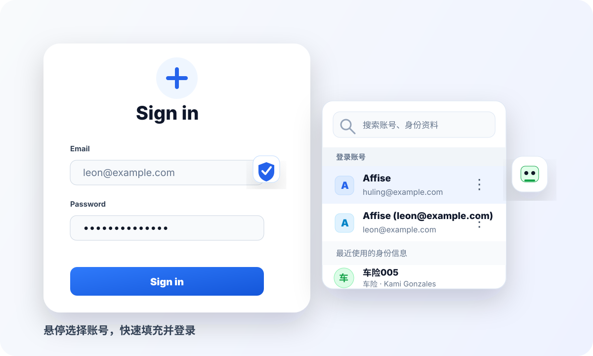
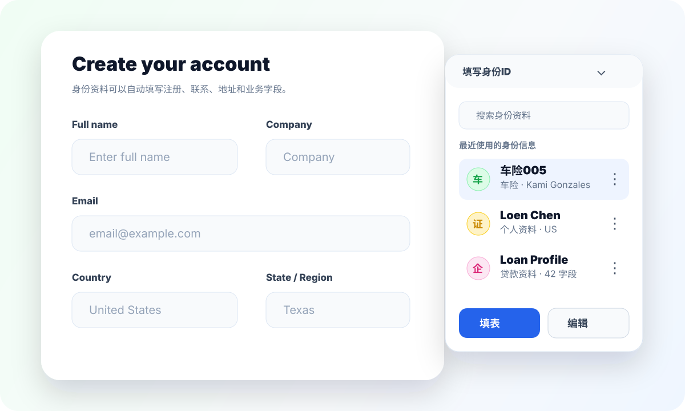
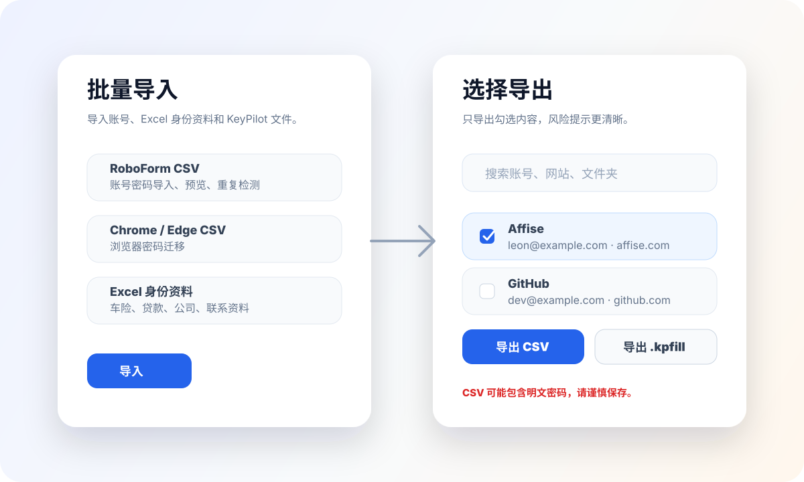
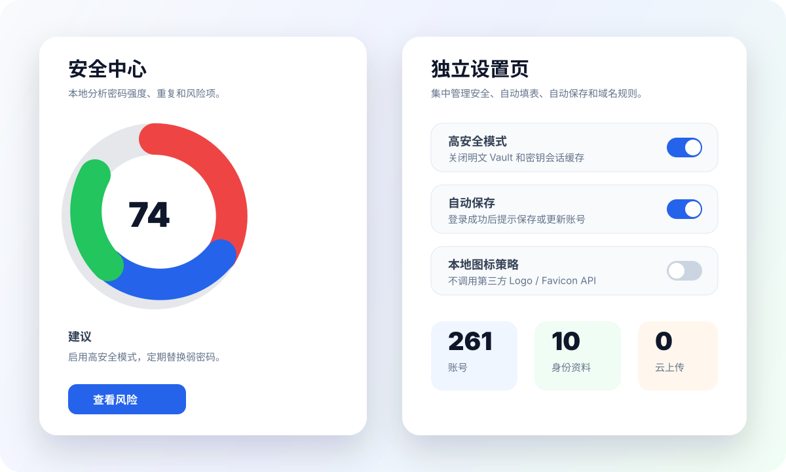
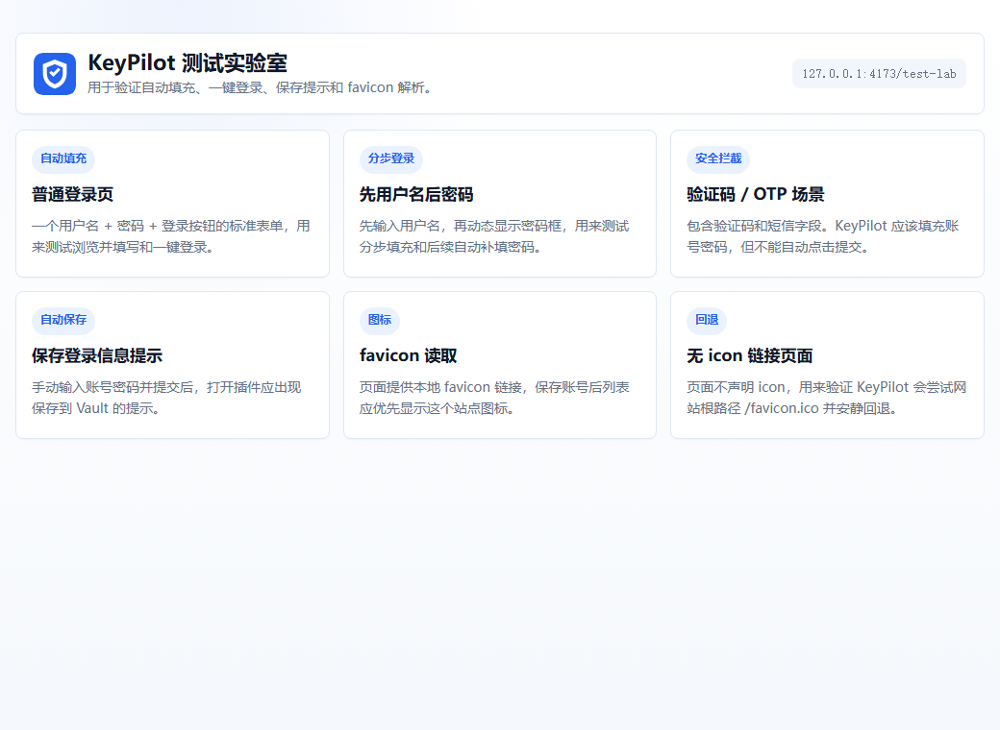

<p align="center">
  
</p>

<h1 align="center">钥航 KeyPilot</h1>

<p align="center">
  本地优先的浏览器密码管理、自动填表、身份资料填写和一键登录插件。
</p>

<p align="center">
  <a href="#简体中文">
    
  </a>
  <a href="#english">
    
  </a>
  <a href="https://github.com/tigersvip/keypilot-extension/releases">
    
  </a>
</p>

<p align="center">
  
  
  
  
</p>

<p align="center">
  
  
  
  
  
</p>

<p align="center">
  
</p>

> Beta Preview：KeyPilot 尚未经过第三方安全审计。正式保存重要账号前，请先在测试环境验证并自行评估安全风险。

---

## 简体中文

钥航 KeyPilot 是一个本地优先的浏览器密码管理、自动填表、身份资料填写和一键登录插件，适用于 Chrome、Edge 以及其他 Chromium 内核浏览器。

它的核心目标很明确：账号、密码、生成密码和结构化填表资料只保存在本机加密 Vault 中，不依赖云端同步，不调用第三方 Logo / Favicon 服务，不把用户保存的网站域名或资料发送给外部服务。

### 界面预览

新增可选的[浏览器声音提醒](docs/reminders.md)：在“设置 → 提醒”开启，支持粘贴文字识别多条到期事项、四种本地合成提示音和手动确认。无需桌面程序；提醒与声音设置包含在完整加密备份中。

| Vault 管理页 | 网页内快捷填充 |
| --- | --- |
|  |  |

| 身份资料填表 | 导入与导出 |
| --- | --- |
|  |  |

| 安全中心与设置 | 测试实验室 |
| --- | --- |
|  |  |

### 功能亮点

| 模块 | KeyPilot 支持 |
| --- | --- |
| 本地加密 Vault | 使用主密码保护本地 Vault，账号和资料加密保存。 |
| 一键登录 | 打开网站、填写用户名和密码，并在安全条件满足时尝试点击登录按钮。 |
| 网页内快捷菜单 | 在登录框和表单字段旁显示轻量 KeyPilot 菜单。 |
| 图形验证码识别（实验） | 一键登录时本地识别字符或简单算术验证码、填写首选结果并提交一次；单独识别可按 Enter 确认。无需联网服务。 |
| 密码生成器 | 支持长度、大小写、数字、符号、排除字符、必须包含字符。 |
| 身份验证器 TOTP | 本地生成动态验证码，支持 Google 迁移 / 标准二维码导入、账号关联、验证码填写、单个二维码导出、复制、编辑、移除与恢复。 |
| 密码历史与网站恢复码 | 保留最近 10 次旧密码；网站备用码单独加密保存，可标记已使用；随完整备份恢复。 |
| 账号导入导出 | 支持 RoboForm、Chrome、Edge、通用 CSV 导入；支持勾选指定账号导出 RoboForm CSV。 |
| 身份资料填表 | 支持 Excel、CSV、`.kpfill` 导入结构化资料，用于网页批量填表。 |
| 本地图标策略 | 优先读取网页声明的 icon 或 `/favicon.ico`，不调用 Google Favicon / Clearbit Logo API。 |
| 高安全模式 | 关闭解锁 Vault 和 AES 密钥的会话缓存，降低本机缓存暴露面。 |

### 为什么本地优先

身份验证器的使用方法及当前范围见 [身份验证器与备份提醒](docs/authenticator.md)。

- 不需要远程账号。
- 插件不会上传保存的账号密码。
- `chrome.storage.local` 里只保存加密后的 Vault。
- 主密码不会持久化保存。
- 网站图标不使用第三方 Logo 服务。
- CSV / `.kpfill` 导出由用户显式选择和确认。

### 安装方式

#### 方式一：加载已解压扩展

```bash
npm install
npm run build
```

然后打开：

- Chrome：`chrome://extensions/`
- Edge：`edge://extensions/`

开启“开发者模式”，点击“加载已解压的扩展程序”，选择生成的 `dist/` 目录。

#### 方式二：下载 Release 包

下载后解压，在浏览器扩展管理页选择“加载已解压的扩展程序”，加载解压目录。

<!-- current-release:start -->
当前源码版本：**1.15.2**。安装包：`keypilot-extension-v1.15.2.zip`。

在 [Releases](https://github.com/tigersvip/keypilot-extension/releases) 查看已发布的安装包、更新说明与 SHA-256 校验文件；开发分支版本不一定已经发布。
<!-- current-release:end -->

- 一键登录遇到网站证书错误时会显示独立提示，并等待最多 15 分钟。请自行核实并处理浏览器证书警告；网页正常打开后，插件核对地址及解锁状态再继续填写。可以随时取消等待，关闭目标标签页也会取消。插件不会自动跳过证书警告。

### 1.15.0 网站填写管理

- 设置 → 自动填表 → 域名，可搜索默认资料、网站填写例外和字段绑定；也可从“管理网站填写设置”直接进入。
- 网站偏好按协议、域名和端口分别保存。字段绑定按具体域名及路径应用，不含其他子域名，不区分协议和端口；清除前会显示范围并确认。
- 校准面板可以收起、拖动；聚焦移动按钮后也可按方向键移动。点击网页字段后自动展开，保存按钮固定在底部。移除全部字段后可以清除原有绑定。
- 所有设置继续随完整加密备份导出。合并时选择“站点识别规则”恢复网站偏好，资料自带的字段绑定随相应资料恢复。

### 1.14.0 网站默认资料与字段校准

- 按 Ctrl+Shift+L 选择资料后，在预览中勾选“设为此网站默认资料”。下次在同一网站直接预览；可随时切换资料，取消勾选并确认可清除默认项。已有内容无需改动，也能单独保存默认设置。设置按协议、域名和端口区分，仍需预览确认。
- 点击“校准未匹配字段”，先点网页上的漏填框，再选择资料字段，保存后重新测试。快捷填写校准限定在原来选中的表单内。
- 默认资料和字段绑定随完整加密备份恢复，合并冲突时默认资料跟随正确记录；删除资料会清除其默认设置。
- GitHub 自动检查测试、版本一致性和安装包体积。发布步骤见 [版本发布](docs/releasing.md)。

### 1.12.0 紧凑管理界面

- 管理页采用 48px 单行列表与 16px 账号名称；常用操作直接可见，其余在“更多”，也支持右键菜单。
- 主目录归入文件夹，侧栏减少留白；设置整理为一般、账户与数据、登录与安全、自动填表、高级设置、关于与工具六组。
- 详情优先展示账号信息，绑定说明与验证码关联折叠；验证码并排显示，复制结果在按钮旁提示。
- 搜索后用上下键选择，Enter 执行焦点按钮标注的动作（弹窗登录、管理页查看），Escape 返回搜索或清空搜索。输入法选字不触发列表导航。

### 1.11.0 界面整理

- 功能弹窗统一顶部返回与菜单，验证器列表更紧凑；首页继续使用可读的单行账号列表。
- 窄窗口详情使用完整内容区，返回、编辑和保存操作固定在顶部。
- 网站开关显示实际生效状态，可直接跳转总开关设置；详细说明与重置折叠。

### 1.10.0 网站设置与登录进度

在账号详情展开“此网站设置”，可统一调整账号填写、登录时自动点击、图片验证码识别、网站首选账号和 TOTP 自动填写。设置按完整网站来源（协议、域名、端口）保存。全局自动点击与图片识别总开关仍然有效；首选账号只调整匹配列表顺序，不会未经选择自动登录。恢复默认设置保留账号及表单绑定，并关闭此网站的 TOTP 自动填写。

TOTP 支持密码与验证码在同一表单的登录场景；关联多组身份验证器时，可以为此登录账号指定默认项。账号和验证码框必须明确匹配，已有内容不会覆盖；锁库、设置变化、输入修改或验证码过期会暂停。同页验证通过填写后随本次明确的一键登录提交一次，独立的第二步验证页仍只填写，不点击确认按钮。

网页右下角显示紧凑的登录进度，说明正在填写、已提交、等待新验证码或需要手动处理。需要操作时可直接打开账号详情。页面跳转和登录框消失只作为待确认信号，不再增加站点规则的成功次数；只有明确页面错误才增加失败次数。网站设置、首选账号及默认验证码随完整加密备份保存，合并恢复时跟随冲突处理后的记录 ID。

### 1.9.0 登录操作统一与 TOTP 衔接

网页、弹窗、管理页的一键登录统一遵循“允许一键登录自动点击登录按钮”开关；关闭时只填写账号。每次明确操作只提交一次，不因停留在原页面重复点击。网站错误会区分验证码、账号密码或其他提示。

验证码识别失败时直接显示可编辑结果，点击“继续登录”或按 Enter 即可填写并继续；已自动提交但被网站拒绝时，可点“修正验证码”继续。关闭面板、修改账号密码、锁库或超过两分钟后取消继续登录。单独打开的识别仍仅填写。

账号详情关联唯一的身份验证器后，可按网站开启“一键登录后自动填写动态验证码”（默认关闭）。支持明确的验证器字段、分格输入和同源 iframe，临近过期自动等下一组；不接管短信、邮件、恢复码或跨源验证页面。开关随完整加密备份与站点规则恢复，详见[身份验证器说明](docs/authenticator.md)。更新后重新加载扩展并刷新网站页面。

### 1.8.9 一键登录自动处理图形验证码（实验功能）

开启本地验证码识别后，一键登录会填写账号密码、识别并填写首选验证码结果，随后提交一次。只填表或单独打开识别面板仍保留手动操作；识别失败、图片变化、用户修改、锁定或其他验证项会暂停，不反复猜码提交。复用现有模型，没有增加依赖、权限或模型文件。更新后重新加载扩展并刷新网站页面。

### 1.8.8 验证码区域判断与网站兼容（实验功能）

先确认输入框与图片属于图形验证码，再识别内容。兼容中文、英文及部分国际化标签、ARIA 关联、动态表单、HTTP(S) iframe 和开放的 Shadow DOM；不绑定特定网站。结合图片标记、独立字段区域及明确关联判断，排除短信／邮件／OTP、搜索、优惠码、订单号、卡片安全码、普通计算器、Logo 和二维码。多张图片同样可疑时不随便选第一张；不能保证所有网站都正确匹配，缺少线索时保留手动输入。

在面板折叠选项中点击“此网站不再提示”，可以按协议、域名和端口关闭。设置里的“已记住的验证码网站规则”可清除并恢复提示，关闭状态随完整加密备份及所选站点规则恢复。页面语言适配不扩大 OCR 的字符范围，不支持中文图片文字、滑块或行为验证。

### 1.8.7 自动算术识别与完整字符复核（实验功能）

同一个“识别验证码”入口自动判断普通字符和简单算术题，不需要选择类型。识别到 `8 × 3 = ?` 会直接在结果框填入 `24`，同时显示算式供核对，按 Enter 即可填写。算术输出层与原模型共享编码器，使用 2,000 张本地合成图训练，压缩模型只增加 9,973 字节；原编码器和已有输出权重不变。普通字符复用已有图片视图的完整读数，减少漏字结果排在前面的问题。训练库、训练图片不进入插件。

- 在“设置 → 自动填表 → 本地验证码识别”开启，默认关闭；启用状态随完整加密备份保存。
- 网页验证码输入框旁出现“识别验证码”。支持简单数字、英文字母和部分轻微倾斜、彩色背景图片；结果可以修改或选择候选，确认填写后手动登录。
- 面板里的“网站位数提示”是可选项。普通字符沿用保存的位数；算术答案支持一位数、零、负数和有限小数，不受普通字符位数限制，也不修改旧规则。规则按协议、域名和端口分别保存，可在设置中清除，并随完整加密备份导出。
- 自动识别数字、大小写英文字母和常用符号，无需选择字符类型。保留短横线、星号等短字符，有冲突时默认选用首选并提示核对，可直接确认或修改。全部在本机处理，空闲 60 秒后释放识别 Worker。`npm run package` 会校验压缩包不超过 10 MB、安装文件不超过 15 MB，超出则拒绝生成包。
- 新 120 张算术合成图自动计算首选正确 113 张；支持两个整数的加减乘除及常见运算符写法，不处理连算、中文数字或需要约定舍入的答案。新 192 张普通字符压力图相较 1.8.6 首选正确 111→121，候选含答案 134→138，11 张首选改善、1 张回退；严重干扰叠加组仍为 0/32。这些是合成测试，不是实际网站准确率。不支持滑块、点选或行为验证，短信／邮箱／TOTP 使用各自流程。
- 更新后重新加载扩展并刷新已打开的网页。使用方法、兼容限制与合成样本验证见[本地验证码识别说明](docs/captcha.md)。

### 1.7.0 浏览器声音提醒

- 默认关闭，可在“设置 → 提醒”开启；支持手动新建、关联账号、粘贴文字识别多条到期事项并核对保存。
- 四种本地合成提示音可选，音量可调，无音频文件。到点弹窗，每 15 秒响一次，手动确认后停止。
- 密码库锁定时隐藏标题并继续提醒；浏览器完全退出期间无法响铃，下次启动补提醒。
- 提醒、确认状态与声音设置随完整加密备份导出、恢复。详见[浏览器提醒说明](docs/reminders.md)。

### 1.6.0 账号安全与 2FA 联动

- 在验证器“更多 → 编辑与关联”中选择登录账号，也可在账号详情关联已有验证码。详情直接提供查看、复制和填写，支持单框与 6/8 位分格输入；填写前选择匹配的网页。
- “更多 → 导出二维码 / 链接”支持迁移到标准 TOTP 验证器，强制验证主密码，在本地生成二维码并可下载 PNG。
- 账号详情的“密码历史”“网站恢复码”默认折叠；旧密码保留最近 10 次，恢复码可逐个标记使用状态。这些数据和 2FA 关联都包含在完整加密备份中。
- 备份合并冲突逐条选择“保留现有 / 使用备份 / 两份都留”，预览数量随选择变化，保留两份时正确关联新账号。设置统计计入 2FA，页面后台停止验证码刷新。

密码历史从升级后的修改开始记录；恢复旧密码仅修改本地记录，不会修改网站密码。完整使用范围见[身份验证器说明](docs/authenticator.md)及[备份说明](docs/backup.md)。

### 1.5.0 完整备份与恢复

- 管理页顶部“完整备份”进入设置的“账户&数据”。选择“导出完整加密备份”，账号、2FA 密钥及参数、笔记、资料、文件夹、回收站、插件设置和规则一起加密导出。
- 新安装可直接选择“已有备份？直接恢复”，使用备份对应的主密码恢复，无需先创建空库。
- 合并预览显示新增、重复和冲突；重复跳过，冲突默认保留两份，1.6 起支持逐条选择。默认保留当前主密码和设置，也可勾选恢复指定配置类别；替换模式使用备份的全部数据、主密码和设置。
- 设置、黑名单、站点规则或字段映射单独变化也会提醒备份。下载发起时间不代表文件已经保存成功。

账号 CSV/JSON、`.kpfill` 和站点规则文件是分类导出，不包含整个密码库。详细范围和恢复步骤见[完整备份与迁移](docs/backup.md)。

### 1.4.2 Google 迁移二维码兼容

修复仅因 Google 迁移格式版本不是 0/1 就拒绝导入的问题。结构兼容的二维码按实际账号字段校验，保留分片进度、重复识别和加密保存；详细用法见[身份验证器说明](docs/authenticator.md)。

### 1.4.1 兼容修复

- 修复普通 HTTP 网页保存登录信息时的 `crypto.randomUUID is not a function` 报错，使用安全随机数生成兼容的 UUID。
- 网页中的插件标志和默认站点图标改为内嵌 SVG，避免加载扩展图片被拦截。
- 更新后在扩展管理页重新加载插件，再刷新已经打开的网页；错误列表中的旧记录可手动清除。

### 1.2.3 本地改进版

更新后请在浏览器扩展管理页点击“重新加载”，并重新解锁。已有加密密码库无需转换；原有未保存页面请先保存再更新。

- 管理页、弹窗、设置页统一使用 Segoe UI / 微软雅黑。生成器按钮和选项统一为 15px，辅助说明为 13px；复制、保存、导入导出主按钮在悬停时保持清晰对比。
- 弹窗参考 RoboForm 的阅读比例，使用 16px 账号文字、42px 行高和 28px 网站图标；全部记录可滚动查看，同名账号以用户名区分。顶部统一搜索，详情入口在行右侧，设置与网页识别修复在“更多操作”中。
- 浏览器内部页面不显示网站匹配。普通网页可点击“本站 N 条”筛选，再选择需要的账号；点击“显示全部账号”返回完整列表。
- 当前网站默认精确匹配主机名。需要跨子域时，在账号的匹配网址中显式填写，例如 `https://*.example.com/login/*`。`www.example.com` 与 `example.com` 默认分别匹配。
- 高安全模式的会话只在后台内存保留。后台休眠后会锁定，这是该模式的预期行为。
- 恢复备份默认合并；选择替换后使用备份对应的主密码。恢复点受创建时的主密码保护，不等于免密恢复。
- 剪贴板读取权限只用于到期时比较插件刚复制的内容，避免清掉后来复制的文字；不会记录或上传剪贴板。
- 默认快捷键：Ctrl+Shift+Y 打开弹窗、Ctrl+Shift+L 填写账号或个人资料、Ctrl+Shift+K 锁定、Ctrl+Shift+F 搜索。浏览器快捷键冲突时，在设置的“快捷键”页查看并重新配置。
- 快捷填写：先点击目标表单中的输入框，再按 Ctrl+Shift+L。登录表单填写匹配账号，多账号先选择；个人资料表单使用“个人信息”中保存的填写资料，多份资料支持搜索和键盘选择，单份直接预览。只补空白项，确认后填写、不自动提交，可在 2 分钟内撤销。
- 同页多表单优先处理光标所在表单，不确定时先选择；支持可识别的中英文输入框、下拉框、多行文本和同源 iframe。跨源 iframe 需要主动聚焦并确认来源，未聚焦的跨源框架不自动选择。锁库、导航、字段变化或资料更新会停止旧操作；浏览器内部页面与无法识别的特殊控件仍需手动处理。
- 表单预览、撤销、诊断校准和备份恢复均使用本地数据。共享和紧急访问仍在规划中。

### 自动回归测试

```bash
npm ci
npm test
npm run build
npx playwright install chromium
npm run test:e2e
```

核心测试覆盖保存冲突、会话过期、域名边界与备份恢复；浏览器测试使用独立的 Chromium 配置及虚构数据。截图与失败追踪保存在 `output/playwright/`，不会加载日常浏览器配置。第三方网站、Edge 和 360 浏览器的兼容性仍需逐站验证。

### 本地开发

```bash
npm install
npm run build
npm run lab
```

如果 PowerShell 阻止 `npm.ps1`，可以使用：

```bash
npm.cmd install
npm.cmd run build
npm.cmd run lab
```

测试实验室地址：

```text
http://127.0.0.1:4173/test-lab/
```

### 项目结构

```text
.
├── public/                 # manifest、图标、本地测试页面
├── src/
│   ├── background/         # Manifest V3 service worker
│   ├── content/            # 表单识别、内联菜单、自动填充
│   ├── options/            # 独立设置页
│   ├── popup/              # 浏览器工具栏弹窗
│   ├── shared/             # 加密、Vault、导入导出、域名匹配等共享逻辑
│   └── vault/              # 后台 Vault 管理页
├── popup.html
├── options.html
├── vault.html
└── vite.config.ts
```

### 技术栈

- Manifest V3
- React 18
- TypeScript
- Vite
- Web Crypto API
- Chrome Extension APIs

### 安全模型

KeyPilot 会处理敏感数据，目前安全模型如下：

- 使用 PBKDF2 + SHA-256 派生密钥。
- 使用 AES-GCM 加密 Vault。
- 浏览器扩展存储中保存的是加密 Vault。
- 明文 Vault 只存在于解锁后的运行时会话。
- 高安全模式可关闭解锁会话缓存。
- 导出的 CSV 和 `.kpfill` 可能包含明文敏感数据，请谨慎保存和传输。

如需报告安全问题，请先阅读 [SECURITY.md](SECURITY.md)。

### 当前限制

- 当前仍是 Beta Preview，尚未经过第三方安全审计。
- 真实网站登录流程差异很大，一键登录兼容性还需要持续积累规则。
- 暂无云同步、团队共享、Passkey、泄露监控。
- Firefox 适配尚未开始。

### 后续规划

- 更完整的站点规则库和自动登录失败修复。
- TOTP 更多备份格式与验证码字段适配。
- Passkey / WebAuthn 能力调研。
- 更细的导出权限和加密分享流程。
- 自动化测试和浏览器兼容性矩阵。
- Chrome Web Store 发布材料和隐私说明。

### 贡献

欢迎提交 issue、兼容性案例、站点规则、文档改进和 pull request。请先阅读 [CONTRIBUTING.md](CONTRIBUTING.md)。

### License

MIT License. See [LICENSE](LICENSE).

---

## English

KeyPilot is a local-first browser extension for password management, autofill, identity/profile form filling, password generation, and one-click login. It is designed for Chrome, Edge, and other Chromium-based browsers.

The product principle is simple: credentials, generated passwords, and structured form-fill profiles stay on the user's machine inside an encrypted local Vault. KeyPilot does not depend on cloud sync, does not call third-party logo APIs, and should not send saved domains or private form data to external services.

### Preview

| Vault management | Inline autofill |
| --- | --- |
|  |  |

| Identity form filling | Import and export |
| --- | --- |
|  |  |

| Security and settings | Test lab |
| --- | --- |
|  |  |

### Highlights

| Area | What KeyPilot does |
| --- | --- |
| Encrypted Vault | Stores credentials and profiles locally using a master-password-protected Vault. |
| One-click login | Opens a site, fills username and password, and attempts a safe submit when possible. |
| Inline autofill | Shows a lightweight KeyPilot menu next to login and form fields. |
| Password generator | Supports length, uppercase, lowercase, numbers, symbols, excluded characters, and required characters. |
| Credential import/export | Imports RoboForm, Chrome, Edge, and generic CSV; exports selected credentials to RoboForm CSV. |
| Identity profiles | Imports Excel, CSV, and `.kpfill` profiles for structured form filling. |
| Local favicon | Reads site icons from the page or `/favicon.ico`; never uses Google Favicon or Clearbit Logo APIs. |
| High security mode | Disables unlocked Vault/session key caching for stricter local security. |

### Why local-first

- No remote account is required.
- Saved credentials are not uploaded by the extension.
- Vault data stored in `chrome.storage.local` is encrypted.
- The master password is not persisted.
- Favicon handling avoids third-party logo services.
- Sensitive exports are explicit and user-controlled.

### Install

#### Option 1: Load unpacked extension

```bash
npm install
npm run build
```

Then open:

- Chrome: `chrome://extensions/`
- Edge: `edge://extensions/`

Enable Developer mode, choose **Load unpacked**, and select the generated `dist/` folder.

#### Option 2: Release package

Download from [Releases](https://github.com/tigersvip/keypilot-extension/releases):

- `keypilot-extension-v1.1.zip`: recommended for local testing. Extract it and load the extracted folder.
- `keypilot-extension-v1.1.crx`: packaged CRX build. Some browsers may block direct installation of external CRX files.

### Development

```bash
npm install
npm run build
npm run lab
```

If PowerShell blocks `npm.ps1`, use:

```bash
npm.cmd install
npm.cmd run build
npm.cmd run lab
```

The local test lab runs at:

```text
http://127.0.0.1:4173/test-lab/
```

### Project structure

```text
.
├── public/                 # manifest, icons, and local test pages
├── src/
│   ├── background/         # Manifest V3 service worker
│   ├── content/            # form detection, inline menu, autofill
│   ├── options/            # standalone settings page
│   ├── popup/              # browser toolbar popup
│   ├── shared/             # crypto, Vault, import/export, matching
│   └── vault/              # full Vault management page
├── popup.html
├── options.html
├── vault.html
└── vite.config.ts
```

### Tech stack

- Manifest V3
- React 18
- TypeScript
- Vite
- Web Crypto API
- Chrome Extension APIs

### Security model

KeyPilot handles sensitive user data. The current model is:

- PBKDF2 + SHA-256 for key derivation.
- AES-GCM for Vault encryption.
- Encrypted Vault data is stored in browser extension storage.
- Plain Vault data only exists in an unlocked runtime session.
- High security mode can disable unlocked session caching.
- Exported CSV and `.kpfill` files may contain plaintext sensitive data and should be handled carefully.

Read [SECURITY.md](SECURITY.md) before reporting vulnerabilities.

### Current limitations

- Beta preview, not security-audited.
- Website login flows vary widely; one-click login compatibility still needs more rules and testing.
- No cloud sync, team sharing, passkey support, or breach monitoring yet.
- Firefox support has not started.

### Roadmap

- Larger site-rule library and auto-login repair flows.
- More authenticator backup formats and broader OTP field support.
- Passkey / WebAuthn research.
- More granular export permissions and encrypted sharing.
- Automated tests and browser compatibility matrix.
- Chrome Web Store release assets and privacy documentation.

### Contributing

Issues, compatibility cases, site rules, documentation improvements, and pull requests are welcome. Please read [CONTRIBUTING.md](CONTRIBUTING.md).

### License

MIT License. See [LICENSE](LICENSE).
